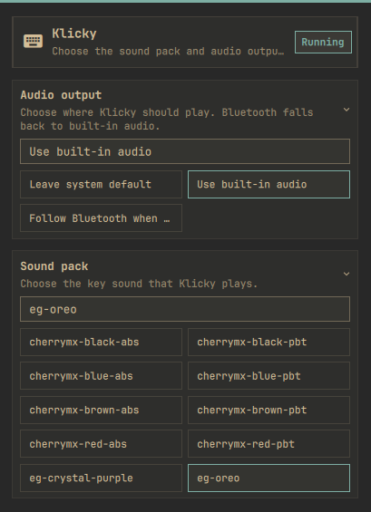

# Klicky Omarchy Plugin

An Omarchy bar widget for [Klicky](https://github.com/Muneer320/klicky), the
local mechanical keyboard sound daemon.


The widget shows whether `klicky.service` is running and toggles it with a
left click. Right-click opens themed controls for selecting the installed
sound pack and audio output policy. The Bluetooth policy follows a connected
Bluetooth sink and falls back to built-in audio until Bluetooth is available.
It does not read keyboard events, play audio, install packages, or run
privileged commands itself.

## Requirements

- Omarchy Quattro with third-party plugin support
- Klicky installed and available as a user service
- `klicky.service` installed for the current user

Install Klicky separately by following its official instructions:

```bash
curl -fsSL https://klicky.muneer320.tech/install.sh | bash
```

The installer is intentionally separate because Omarchy marketplace plugins
are cloned and loaded as shell code; they do not run install hooks or request
sudo.

## Install

From a public Git repository:

```bash
omarchy plugin add https://github.com/matrix-node/klicky-omarchy-plugin.git --enable
```

Or validate a local checkout:

```bash
omarchy plugin validate .
```

To remove the bar widget:

```bash
omarchy plugin remove io.github.matrix-node.klicky --yes
```

Removing the widget does not uninstall Klicky. To remove Klicky separately,
follow Klicky's official uninstall instructions.

## Usage

The widget appears in the center bar. Click it to start or stop Klicky.
Sound-pack and volume settings remain Klicky's responsibility:

```bash
klicky list
klicky switch cherrymx-brown-pbt
klicky volume 0.4
```

The widget's audio policy changes the PipeWire default sink for the user
session. `Leave system default` makes no routing changes, `Use built-in audio`
selects the first local ALSA sink, and `Follow Bluetooth when connected`
selects a Bluetooth sink when available and otherwise falls back to local
audio.

## Development

The plugin is a small companion to Klicky rather than a replacement for its
evdev listener and audio daemon. This keeps the Omarchy integration focused,
avoids duplicate key event readers, and allows Klicky to be updated
independently.

The plugin has no install hooks, network access, package installation, or
privileged operations. It only invokes `systemctl --user` to start and stop
the documented Klicky user service.

## Screenshots



Validate changes with:

```bash
omarchy plugin validate .
qmllint -I "${OMARCHY_PATH:-/usr/share/omarchy}/shell" BarWidget.qml
```

## License

MIT
